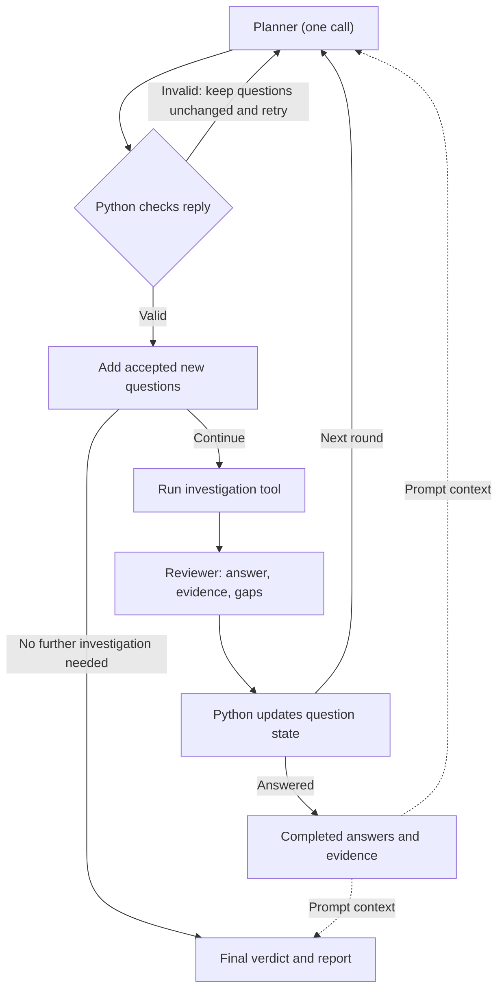

# Agentic SOC

Agentic SOC is a cloud-security investigation project that generates repeatable AWS Identity and Access Management (IAM) attack scenarios and turns the resulting CloudTrail telemetry into Elastic Security detections and alerts.

The telemetry and detection pipeline uses AWS CloudTrail, S3, SQS, Elastic Agent, Elasticsearch, and Elastic Security. The project also includes an authenticated FastAPI webhook for alert intake, with a LangGraph/LangChain investigation layer under active development for automated evidence gathering, event correlation, and structured investigation findings.

## Architecture

```text
AWS activity
    ↓
CloudTrail
    ↓
S3
    ↓
SQS
    ↓
Elastic Agent
    ↓
Elasticsearch
    ↓
Elastic Security alert
    ↓
FastAPI webhook
    ↓
LangGraph investigator
```

## Repository Structure

```text
infra/terraform/     AWS infrastructure
scripts/scenarios/  repeatable security scenarios
scripts/elastic/    Elastic configuration automation
src/agentic_soc/     Agentic SOC application code
docs/               design and implementation notes
```

## Investigation Model

The investigator is designed around six questions:

```text
Who   — who performed the activity?
When  — when did it occur?
Where — where did it originate?
How   — how did access change?
What  — what happened afterward?
Why   — is there evidence of a legitimate explanation?
```

The investigation workflow is designed to produce structured findings with a timeline, supporting evidence, and explicit uncertainty.

### Planned investigation workflow

One Planner call assesses the supplied questions and proposes new questions in separate output fields. Python checks the reply before adding new questions.



The Planner receives the original alert, active questions, evidence gaps, and completed answers as prompt context. Completed questions are retained as reference and excluded from selection. The final verdict uses the original alert, accumulated findings, completed answers, and remaining gaps.

## Security

Secrets, API keys, Terraform state, and runtime scenario state are excluded from version control.
